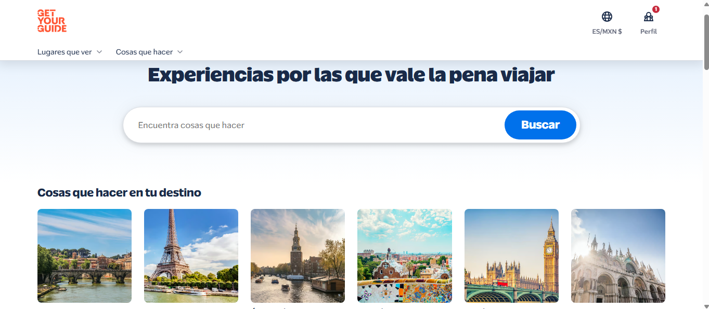
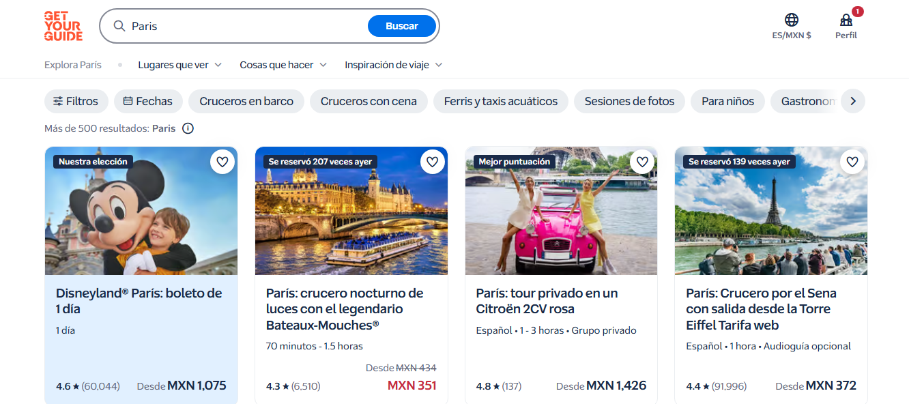

# Wanderlust Explorer con React y Next.js
Este es un proyecto para hacer una pagina similar a wanderlust Explorer

## Cómo ejecutar el proyecto

Requisitos: Node.js 20.9 o superior y npm.

Instala las dependencias:

```bash
npm ci
```

Inicia el servidor de desarrollo:

```bash
npm run dev
```

Abre [http://localhost:3000](http://localhost:3000) en el navegador.

Para generar y ejecutar la versión de producción:

```bash
npm run build
npm run start
```

Para revisar el código con ESLint:

```bash
npm run lint
```

## Design References

Inspiración visual: [GetYourGuide](https://www.getyourguide.com/). Las capturas muestran la jerarquía de búsqueda en la página de inicio aunque para esta, el diseño lo cambié por algo más minimalista y la presentación de resultados filtrados por destino.

### Home y búsqueda

Referencia: [GetYourGuide](https://www.getyourguide.com/)



### Resultados filtrados

Referencia: [GetYourGuide: actividades en París](https://www.getyourguide.com/)


